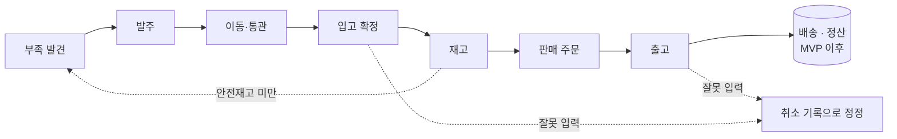
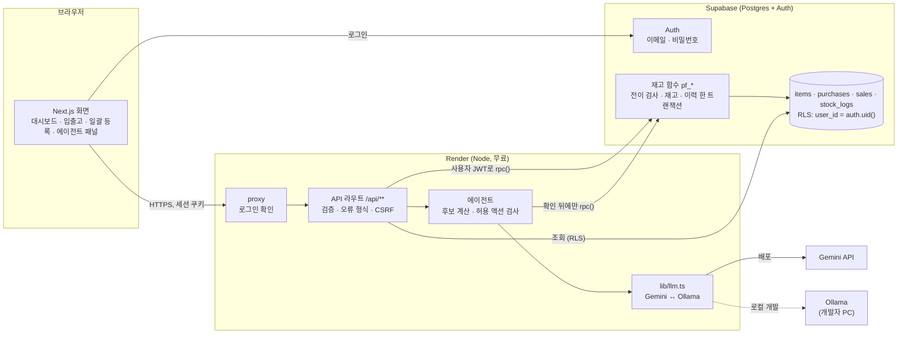

# 01. 엔터프라이즈 아키텍처

작성일: 2026-11-20 · 표기: 결정 [D-번호 · P-번호](02-decisions.md) (모두 확정)

## 1. 네 층으로 보기

위층의 요구가 아래층의 선택을 정한다. 아래층을 바꿀 때는 위층의 어떤 요구를 지키려는지 먼저 적는다.

| 층 | 질문 | PackFlow의 답 |
|---|---|---|
| 비즈니스 | 누가 무엇을 얻는가 | 판매자 1인이 구매 · 입고 · 판매 · 출고를 한곳에서 처리하고, 재고가 언제 왜 바뀌었는지 설명할 수 있다 |
| 애플리케이션 | 어떤 기능 단위가 있는가 | 품목 마스터, 구매 · 입고, 판매 · 출고, 재고 원장(이력), 일괄 등록, 대시보드, AI 에이전트, 인증, 시연 데이터 |
| 데이터 | 어떤 데이터가 어디에 있고 누가 바꾸는가 | 4테이블(`items` · `purchases` · `sales` · `stock_logs`) + LLM 사용량. 모두 Supabase Postgres, 사용자별 격리(RLS). 재고는 DB 함수만 바꾼다 |
| 기술 | 무엇으로 돌리는가 | Next.js(Render), Supabase(개발 · 테스트용 / 시연용 2개), Gemini(배포) · Ollama(개발), GitHub + Actions |

## 2. 비즈니스 층

### 2.1 가치 흐름

### 2.2 참여자

| 참여자 | 시스템 안/밖 | 하는 일 |
|---|---|---|
| 판매자 (계정 A · B) | 안 | 품목 등록, 발주 · 입고 확정, 판매 등록 · 출고, 취소, 에이전트 사용 |
| 공급처 (국내 · 해외) | 밖 | 발주서를 받는다. MVP에서는 '발송(시연용)' 표시만, 실제 메일 발송 없음 |
| 판매 채널 (스마트스토어 · 쿠팡 등) | 밖 | 주문이 생기는 곳. MVP에서는 판매자가 CSV로 옮겨 붙인다 |
| 세무사 | 밖 (MVP 이후) | 월별 요약 CSV를 받는다(고도화 후보) |

### 2.3 업무 능력(capability) 지도

| 능력 | MVP Step | 고도화 후보 (계획서 4절) |
|---|---|---|
| 품목 마스터 관리 | 1 | 세트 · 로트, 바코드 |
| 구매 · 입고 관리 | 1, 3 | 거래처별 단가 이력, 판매 채널 연동 |
| 판매 · 출고 관리 | 1, 3 | 배송 단계, 반품 · 교환, 백오더 |
| 재고 원장 · 감사 | 1, 3 | 재고 실사 · 조정, 감사 로그 |
| 대량 입력 | 3, 4 | 엑셀 예외 고도화, 사진 OCR |
| 의사결정 지원 (AI) | 5 | 추세 제안, 재주문점, ABC 분석, 알림 |
| 계정 · 권한 | 2 | 구글 로그인, 역할별 권한 |
| 정산 · 자금회수 | — | 자금회수, 마진 리포트, 월별 내보내기 |

## 3. 애플리케이션 층

### 3.1 모듈과 담당

| 모듈 | 하는 일 | 코드 위치 ([06](06-work-plan.md) 소유 구역) | 담당 |
|---|---|---|---|
| 인증 | 로그인 · 로그아웃, 세션 쿠키, 미로그인 차단 | `src/app/login/`, `src/proxy.ts`, `src/lib/supabase/` | eple |
| API 게이트 | 모든 변경 요청의 입구. 입력 검증, 오류 형식, CSRF 확인 | `src/app/api/**`, `src/lib/api/` | eple (에이전트 라우트는 skygaul) |
| 재고 엔진 | 입고 확정 · 출고 · 취소 · 상태 전이 · 이력 기록. **한곳** | 함수 `supabase/migrations/*_inventory.sql`, 호출 래퍼 `src/lib/inventory.ts` | sorek-charlie(함수 본문), eple(래퍼) |
| 앱 뼈대 · 공통 | 레이아웃 · 내비 · 에이전트 패널 자리, 공통 화면 조각, fetch 래퍼 · 목, 환경변수 · 시간 · 로그 유틸, 파트 간 계약 타입 | `src/app/(app)/layout.tsx`, `src/components/{layout,common}/`, `src/lib/{api-client,env,time,log}.ts`, `src/lib/mock/`, `src/types/`, `src/components/agent/open.ts` | eple |
| 일괄 등록 | TSV · CSV 파싱 → 미리보기 → 유효 행만 반영 | 파싱 `src/lib/bulk/`, 반영 `pf_bulk_apply`(재고 엔진 함수를 묶어 부름) | jkspawn(화면 · 파싱), eple(반영 함수 · 라우트) |
| 대시보드 | KPI, 파이프라인 건수, 품목별 재고, 품절 임박 | `src/app/(app)/page.tsx`, `src/components/dashboard/` | jkspawn |
| 품목 화면 | 품목 목록 · 등록 · 수정(재고 · 코드 읽기 전용, D-22) | `src/app/(app)/items/`, `src/components/items/` | jkspawn |
| 입력 검증 · 표시 | 화면 · 서버 공용 검증 스키마, 오류 문구, 숫자 · 날짜 표시 (04 4절, D-24) | `src/lib/validation/`, `src/lib/format.ts`, `src/lib/api/errors.ts` | eple |
| AI 에이전트 | 발주 후보 계산(코드) → 초안 문안(LLM) → 확인 후 저장 / 자연어 → 허용 액션 → 확인 후 실행 | `src/lib/agent/`, `src/lib/llm.ts`, `src/app/api/agent/`, `src/components/agent/` | skygaul |
| 시연 데이터 | 시드 3벌(시연 · 소량 · 대량), 원클릭 초기화(본인 데이터만) | 초기화 함수 `supabase/migrations/*_seed.sql` · 로더 `src/lib/seed/index.ts`, 데이터 `src/lib/seed/*.json` | eple(함수 · 로더), sorek-charlie(데이터 · 정답표) |
| 테스트 기반 | 테스트 도구 설정, 로그인 · 초기화 도우미, 회귀 실행기 · 측정 스크립트 | `vitest` · `playwright` 설정, `tests/**/helpers.ts`, `tests/regression/run.ts` · `measure.ts` | eple (테스트 케이스는 각 담당, 회귀 실행 · 판정은 sorek-charlie) |

### 3.2 구성도

### 3.3 요청이 지나는 길 (출고 한 번)

1. 화면이 `POST /api/sales/{id}/ship`을 보낸다(헤더 `X-PF: 1`).
2. proxy(Next 16의 옛 middleware)가 세션을 확인한다. 없으면 401.
3. API 라우트가 입력을 검증하고, **사용자 JWT를 실은 Supabase 클라이언트**로 `pf_ship_sale(id)`를 부른다. 서비스 키는 쓰지 않는다(P-03).
4. 함수가 한 트랜잭션에서: 판매 행 잠금 → 주인 확인(`auth.uid()`) → 전이 검사(`출고대기 → 출고완료`) → 품목 행 잠금 → 재고 확인 → `items.stock_qty` 감소 → `stock_logs` 한 줄 추가.
5. 실패하면 전체가 되돌려지고, 함수가 정한 오류 코드가 API의 `{"error":{...}}`로 바뀐다([04](04-api-contract.md)).

화면 폼, 일괄 등록, 챗봇이 **모두 같은 함수**를 지난다. 그래서 규칙을 한 번만 테스트하면 된다.

## 4. 데이터 층

| 데이터 | 종류 | 누가 만들고 바꾸나 | 지우나 |
|---|---|---|---|
| `items` | 마스터 | 사용자(이름 · 단가 · 안전재고). **재고 수량은 함수만** | 시연 초기화 때만 |
| `purchases` | 거래 | 함수만 (생성 · 상태 전이) | 시연 초기화 때만 |
| `sales` | 거래 | 함수만 | 시연 초기화 때만 |
| `stock_logs` | 원장 | 함수만, **추가만** | 시연 초기화 때만 |
| `llm_usage` | 운영 | 함수만 (하루 사용량 증가) | 지우지 않음 (날짜별 한 줄) |
| 인증 사용자 | Supabase Auth | Supabase | — |

불변식: 언제든 품목별 `sum(stock_logs.change_qty) = items.stock_qty`, `stock_qty ≥ 0`. 자세한 것은 [03 데이터 모델](03-data-model.md).

외부로 나가는 데이터: 에이전트가 LLM에 보내는 것은 **품목명 · 수량 · 단가 · 거래처명(가상)** 뿐이다. 사용자 이메일은 보내지 않는다. 무료 티어는 입력이 서비스 개선에 쓰일 수 있어 가상 데이터만 쓴다(계획서 9절).

## 5. 기술 층

| 구성 | 선택 | 환경 | 근거 |
|---|---|---|---|
| 웹 · API | Next.js(App Router) + React + TypeScript | Render Web Service, Node 24 LTS(P-10) | D-03, 계획서 8절 |
| DB · 인증 | Supabase: **`packflow-dev`**(개발 · 테스트) / **`packflow-demo`**(배포 · 시연) | 무료 플랜 2개 | D-11 |
| DB 변경 관리 | `supabase/migrations/*.sql` 저장소에서 관리, Supabase CLI로 적용 | eple이 적용 | P-06 |
| LLM | 배포: Gemini 무료 티어 / 개발: 각자 PC Ollama | `LLM_PROVIDER` 환경변수 | D-06 |
| 테스트 | Vitest(함수 · 단위 · API), Playwright(완료 판정 시나리오) | 로컬 + Actions | D-11 |
| CI | GitHub Actions: PR마다 lint · typecheck · 단위 테스트 | DB가 필요한 테스트는 로컬 | P-11 |

## 6. 설계 원칙과 지키는 방법

계획서 6절의 원칙을 **무엇으로 강제하는지**까지 적는다. 원칙만 적고 강제 장치가 없으면 바이브 코딩 중에 쉽게 깨진다.

| 원칙 | 강제 장치 | 확인 테스트 |
|---|---|---|
| 재고는 이력의 합 | 재고 수량 컬럼에 사용자 UPDATE 권한 없음, 함수 안에서 재고와 이력을 한 트랜잭션으로 | 불변식 검산 (T-INV) |
| 기록은 지우지 않는다 | `stock_logs`에 UPDATE · DELETE 권한 없음, 취소는 반대 기록 함수 | 취소 후 원래 기록 존재 (Step 3) |
| 권한은 DB에서 | 모든 테이블 RLS, 함수 첫 줄에서 `auth.uid()` 확인, 남의 ID는 404 | B → A 직접 호출 거부 (완료 테스트 6) |
| 계산은 코드, 초안은 AI, 실행은 사람 | 추천 수량은 `lib/agent/reorder.ts`가 계산, LLM 응답은 문안 · 액션 JSON만, 실행은 확인 API에서 다시 검증 | 초안 수치 = 계산값, [취소] 시 변화 없음 (Step 5) |
| 꺼져도 동작 | LLM 오류는 에이전트 패널에만 표시, 입출고는 LLM과 무관 | LLM 차단 상태 시연 (Step 5) |
| 코드로 관리 | 스키마 · 정책 · 시드는 마이그레이션 파일, 환경변수는 `.env.example` | 새 PC에서 README대로 재현 (피드백 기준 5) |

## 7. 비기능 요구

| 항목 | 목표 | 메모 |
|---|---|---|
| 가용성 | 발표 시간대에 배포 URL 동작 | Render 무료는 접속이 없으면 잠든다. 발표 직전에 연다. Supabase는 1주 미사용 시 일시정지 |
| 성능 | 대량 시드(품목 10 · 이력 50)에서 대시보드 · 이력 응답 시간 측정 · 기록 | 목표치는 Wave 3에서 처음 측정한 뒤 정한다(Step 4) |
| 보안 | 키는 서버 환경변수, 권한은 DB, 비밀번호는 공개 문서에 없음 | [05 보안](05-security.md) |
| 비용 | 0원. 유료 전환은 팀 합의 후 | LLM 호출 상한 P-09 |
| 재현성 | README와 커밋만으로 다른 PC에서 실행 | 피드백 기준 5 |

## 8. MVP 이후를 위한 자리

고도화 후보가 어느 층을 건드리는지 미리 적어, MVP 설계가 막지 않게 한다.

| 후보 | 건드리는 곳 | MVP에서 미리 해 둘 것 |
|---|---|---|
| 자금회수 · 마진 | `sales`에 컬럼 추가, 대시보드 카드 | 금액 컬럼은 원 단위 정수 |
| 배송 단계 | 판매 전이표에 상태 추가 | 전이표를 함수 안 한곳(`pf_sale_transition_ok`)에 둔다 |
| 구글 로그인 | Supabase Auth 제공자 추가 | RLS를 `auth.uid()` 기준으로만 작성 |
| 역할별 권한 · 감사 로그 | 조직 테이블, 정책 변경 | 함수가 사용자 확인을 한곳(`pf_require_user`)에서 |
| 재고 실사 · 반품 | 새 `reason` 값과 함수 | `reason`은 CHECK 목록이라 값 추가가 쉬움 |
