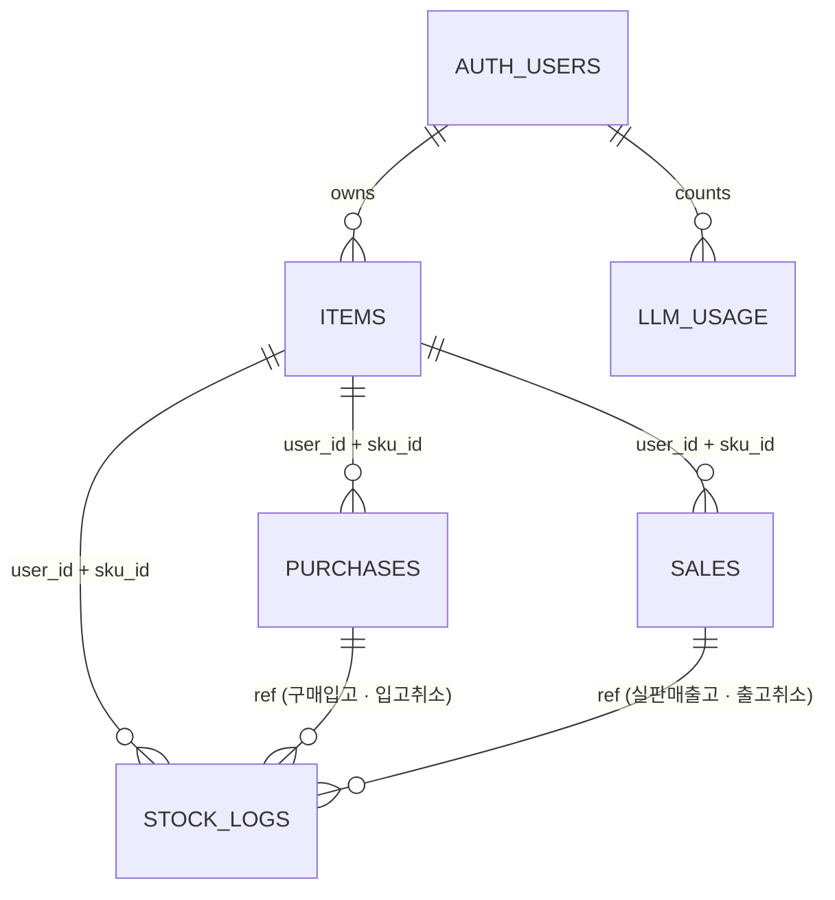
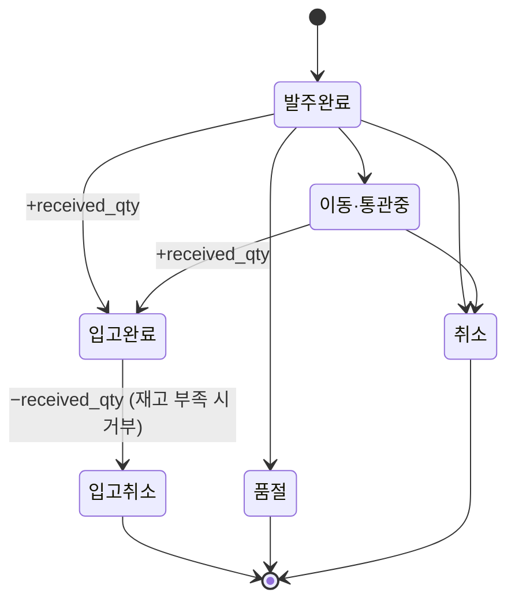
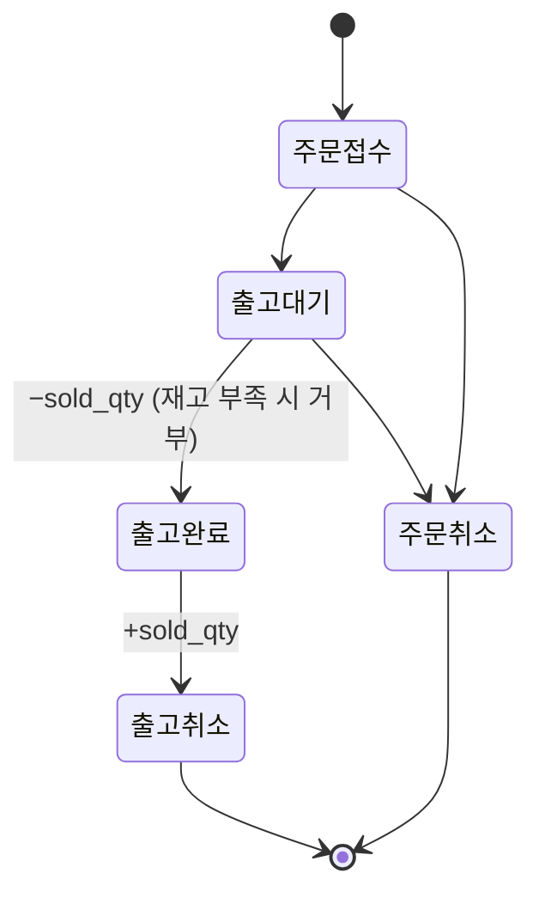

# 03. 데이터 모델

작성일: 2026-11-20 · 근거: 계획서 7절, D-02 · D-07 · D-10, P-04 · P-05 · P-15 · P-16

계획서의 테이블 이름(`Items`, `Purchases` …)은 Postgres 관례에 맞춰 소문자 `items`, `purchases`, `sales`, `stock_logs`로 쓴다. 컬럼 이름은 계획서를 그대로 따른다.

## 1. 관계



## 2. 테이블

금액은 모두 **원 단위 정수**(`integer`). 시각은 `timestamptz`, 화면 표시와 '오늘' 판정은 `Asia/Seoul`.

### `items` — 상품 · 재고 마스터

| 컬럼 | 형 | 규칙 |
|---|---|---|
| `id` | uuid PK | `gen_random_uuid()` |
| `user_id` | uuid | `default auth.uid()`, `auth.users` 참조, not null |
| `sku_id` | text | 예 `PRD-001`. `unique (user_id, sku_id)` |
| `item_name` | text | 1~100자 |
| `source_url` | text null | 구매처 메모. 화면에서 링크로 열지 않고 글자로만 표시 |
| `unit_cost` | integer | ≥ 0 |
| `sale_price` | integer | ≥ 0 |
| `stock_qty` | integer | `default 0`, `check (stock_qty >= 0)`. **사용자 쓰기 권한 없음** — 함수만 바꾼다 |
| `safety_stock` | integer | ≥ 0 |
| `created_at`, `updated_at` | timestamptz | |

### `purchases` — 구매 · 입고

| 컬럼 | 형 | 규칙 |
|---|---|---|
| `id` | uuid PK | |
| `user_id` | uuid | not null |
| `purchase_id` | text | 사람이 읽는 번호 `P-101`. `unique (user_id, purchase_id)`. 함수가 매긴다 |
| `sku_id` | text | `foreign key (user_id, sku_id) references items (user_id, sku_id)` (P-05) |
| `supplier` | text | 거래처명 |
| `order_qty` | integer | > 0 |
| `received_qty` | integer null | 입고 확정 때만. `0 < received_qty ≤ order_qty` |
| `purchase_cost` | integer | ≥ 0 |
| `status` | text | 아래 전이표 값만 (`check`) |
| `invoice_no` | text null | 송장번호. `unique (user_id, invoice_no) where invoice_no is not null` (P-16) |
| `source` | text | `'form' \| 'bulk' \| 'agent' \| 'seed'` — 어디서 만들어졌나 |
| `received_at`, `created_at`, `updated_at` | timestamptz | |

### `sales` — 판매 · 출고

| 컬럼 | 형 | 규칙 |
|---|---|---|
| `id` | uuid PK | |
| `user_id` | uuid | not null |
| `sale_id` | text | `S-201`. `unique (user_id, sale_id)` |
| `sku_id` | text | 복합 외래키 (P-05) |
| `channel` | text | 판매처. 챗봇 직접 출고는 `'직접출고'` (P-14) |
| `sold_qty` | integer | > 0 |
| `sale_amount` | integer | ≥ 0 |
| `fulfillment_status` | text | 아래 전이표 값만 |
| `invoice_no` | text null | 사용자 안에서 판매끼리 중복 불가 |
| `source` | text | 위와 같음 |
| `shipped_at`, `created_at`, `updated_at` | timestamptz | |

자금회수(고도화)에서 `fee_or_shipping`, `payout_amount`, `settlement_status`를 추가한다.

### `stock_logs` — 재고 원장 (추가만)

| 컬럼 | 형 | 규칙 |
|---|---|---|
| `log_id` | bigint identity PK | |
| `user_id` | uuid | not null |
| `sku_id` | text | 복합 외래키 |
| `change_qty` | integer | ≠ 0. 입고 +, 출고 − |
| `reason` | text | `구매입고` / `실판매출고` / `입고취소` / `출고취소` / `재고조정` |
| `ref_type` | text | `'purchase' \| 'sale' \| 'seed'` |
| `ref_id` | text | `P-101`, `S-201` 같은 사람이 읽는 번호 |
| `created_at` | timestamptz | `default now()` |

인덱스: `(user_id, sku_id, created_at desc, log_id desc)` — 품목별 이력과 페이지네이션용.

### `llm_usage` — LLM 호출 수 (P-09)

`(user_id, day date)` PK, `count integer`. 함수 `pf_llm_take()`만 증가시킨다.

## 3. 상태 전이

전이 규칙은 함수 안 **한곳**(`pf_purchase_transition_ok(from, to)`, `pf_sale_transition_ok(from, to)`)에만 둔다. 화면은 "다음으로 갈 수 있는 상태" 버튼만 보여 주지만, 판정은 DB가 한다.

### 구매 `purchases.status`



### 판매 `sales.fulfillment_status`



`출고완료 → 배송중 → 배송완료`는 고도화 후보(배송 단계).

## 4. 재고 함수 (RPC)

D-10에 따라 **재고를 바꾸는 일은 아래 함수만** 한다. 모두 `security definer`, `set search_path = public`, 첫 줄에서 `pf_require_user()`로 `auth.uid()`를 확인한다(P-04). 화면 · 일괄 등록 · 챗봇이 같은 함수를 부른다.

| 함수 | 하는 일 | 재고 · 이력 | 실패 코드 | 담당 |
|---|---|---|---|---|
| `pf_create_item(sku_id, item_name, unit_cost, sale_price, safety_stock, source_url)` | 품목 등록 (재고 0) | — | `PF_VALIDATION`, `PF_DUPLICATE_SKU` | sorek-charlie |
| `pf_create_purchase(sku_id, supplier, order_qty, purchase_cost, invoice_no, source)` | `발주완료`로 생성 | — | `PF_NOT_FOUND`(품목), `PF_DUPLICATE_INVOICE` | sorek-charlie |
| `pf_set_purchase_status(id, to_status)` | 재고 영향 없는 전이 (`이동·통관중`, `품절`, `취소`) | — | `PF_INVALID_TRANSITION` | sorek-charlie |
| `pf_receive_purchase(id, received_qty)` | `입고완료` | `+received_qty`, `구매입고` | `PF_INVALID_TRANSITION`, `PF_VALIDATION` | sorek-charlie |
| `pf_cancel_receipt(id)` | `입고취소` | `−received_qty`, `입고취소` | `PF_INSUFFICIENT_STOCK` | sorek-charlie |
| `pf_create_sale(sku_id, channel, sold_qty, sale_amount, invoice_no, source)` | `주문접수`로 생성 | — | `PF_NOT_FOUND`, `PF_DUPLICATE_INVOICE` | sorek-charlie |
| `pf_set_sale_status(id, to_status)` | `출고대기`, `주문취소` | — | `PF_INVALID_TRANSITION` | sorek-charlie |
| `pf_ship_sale(id)` | `출고완료` (`주문접수`에서 부르면 `출고대기`를 거쳐 한 번에) | `−sold_qty`, `실판매출고` | `PF_INSUFFICIENT_STOCK`(남은 수량을 detail로) | sorek-charlie |
| `pf_cancel_shipment(id)` | `출고취소` | `+sold_qty`, `출고취소` | `PF_INVALID_TRANSITION` | sorek-charlie |
| `pf_bulk_apply(rows jsonb)` | 일괄 등록 반영. 행마다 서브트랜잭션: 유효한 행만 반영, 실패 행은 사유 반환 (P-15) | 행마다 위 함수와 같은 규칙 | 행별 코드 | sorek-charlie |
| `pf_reset_and_seed(data jsonb)` | **본인 데이터만** 지우고 시드를 다시 넣는다 | 초기 재고는 `재고조정` 기록, 이후 이력은 `events`를 위 함수로 차례대로 실행해 만든다 | `PF_VALIDATION` | sorek-charlie |
| `pf_llm_take(user_limit, global_limit)` | 오늘 호출 수 +1, 넘으면 false | — | — | eple (Wave 0) |
| `pf_require_user()` | `auth.uid()`가 없으면 `PF_UNAUTHENTICATED` | — | — | eple (Wave 0) |

### 함수 안 순서 (출고 예)

```text
1. uid := pf_require_user()
2. select ... from sales where id = p_id and user_id = uid for update   -- 없으면 PF_NOT_FOUND (남의 것도 NOT_FOUND, P-07)
3. if not pf_sale_transition_ok(status, '출고완료') then raise PF_INVALID_TRANSITION
4. select stock_qty from items where user_id = uid and sku_id = ... for update
5. if stock_qty < sold_qty then raise PF_INSUFFICIENT_STOCK (detail: 남은 수량)
6. update items set stock_qty = stock_qty - sold_qty
7. insert into stock_logs (..., -sold_qty, '실판매출고', 'sale', sale_id)
8. update sales set fulfillment_status = '출고완료', shipped_at = now()
9. return jsonb (판매 행 + 새 재고)
```

4번의 `for update`가 같은 품목의 동시 출고를 줄 세운다. 그래서 "재고 1에 동시 출고 2건 → 음수 없음"(고도화 '운영 준비')도 MVP 구조에서 이미 막힌다. 검증은 MVP 범위 밖이다.

### 오류 전달 형식

함수는 `raise exception '<코드>' using detail = '<json>'` 형식으로 실패한다. API 라우트(`src/lib/api/errors.ts`)가 코드를 HTTP 상태와 한국어 메시지로 바꾼다([04](04-api-contract.md) 2절). 코드 목록은 `src/types/erp.ts`의 `PfErrorCode`가 원본이다.

## 5. 권한 (RLS · 테이블 권한)

| 대상 | `authenticated` 역할에 주는 것 | 정책 |
|---|---|---|
| `items` | SELECT. UPDATE는 `item_name`, `source_url`, `unit_cost`, `sale_price`, `safety_stock` 컬럼만 | `using (user_id = auth.uid())` |
| `purchases`, `sales` | SELECT만 | `using (user_id = auth.uid())` |
| `stock_logs` | SELECT만 (UPDATE · DELETE 정책 없음) | `using (user_id = auth.uid())` |
| `llm_usage` | 없음 (함수만) | — |
| `pf_*` 함수 | EXECUTE (`pf_require_user`, 전이 판정 함수는 내부용으로 EXECUTE 회수) | 함수 안에서 `auth.uid()` 확인 |
| `anon` 역할 | 아무것도 없음 | — |

- RLS는 **모든 테이블에 켠다**(`enable row level security`). 정책이 없는 테이블은 아무도 읽지 못한다 — 의도한 동작이다.
- `security definer` 함수는 RLS를 우회하므로, **함수 안의 모든 쿼리에 `user_id = uid` 조건**을 넣는다. 빠뜨리면 권한 구멍이다. [05 보안](05-security.md)의 권한 테스트가 이것을 잡는다.

## 6. 불변식과 검산

| 번호 | 불변식 | 확인 방법 |
|---|---|---|
| T-INV-1 | 품목별 `sum(stock_logs.change_qty) = items.stock_qty` | 검산 쿼리(아래). 회귀 테스트 마지막 단계에서 항상 실행 |
| T-INV-2 | `items.stock_qty ≥ 0` | `check` 제약 + 검산 |
| T-INV-3 | `입고완료` 구매마다 `구매입고` 기록이 정확히 1개, `입고취소`면 `입고취소` 기록도 1개 | 검산 |
| T-INV-4 | `출고완료` · `출고취소` 판매도 같은 방식 | 검산 |

```sql
-- T-INV-1: 결과가 0행이어야 한다
select i.sku_id, i.stock_qty, coalesce(sum(l.change_qty), 0) as log_sum
from items i
left join stock_logs l on l.user_id = i.user_id and l.sku_id = i.sku_id
where i.user_id = auth.uid()
group by i.sku_id, i.stock_qty
having i.stock_qty <> coalesce(sum(l.change_qty), 0);
```

## 7. 시드 데이터 (sorek-charlie)

| 벌 | 파일 | 규모 | 쓰임 |
|---|---|---|---|
| `demo` | `src/lib/seed/demo.json` | 품목 8~12, 구매 4~5, 판매 6~8 | 시연 · 원클릭 초기화. 계획서 7절 예시(PRD-001~003)를 포함해 완료 테스트 1 · 2가 바로 이어지게 |
| `small` | `src/lib/seed/small.json` | 품목 5 · 이력 20 | Step 4 정답표 비교 |
| `large` | `src/lib/seed/large.json` | 품목 10 · 이력 50 | Step 4 응답 시간 · 페이지네이션 |

형식:

```json
{
  "items":     [{ "sku_id": "PRD-001", "item_name": "무선 마우스", "unit_cost": 8000, "sale_price": 15000, "initial_qty": 10, "safety_stock": 5 }],
  "purchases": [{ "purchase_id": "P-101", "sku_id": "PRD-001", "supplier": "가나물산", "order_qty": 10, "purchase_cost": 80000, "status": "이동·통관중" }],
  "sales":     [{ "sale_id": "S-201", "sku_id": "PRD-001", "channel": "스마트스토어", "sold_qty": 6, "sale_amount": 90000, "fulfillment_status": "출고대기" }],
  "events":    [{ "op": "ship", "sale_id": "S-199" }, { "op": "receive", "purchase_id": "P-099", "received_qty": 8 }],
  "expected":  { "kpi": { "item_count": 1, "stock_total": 10, "below_safety": 0 }, "stock": { "PRD-001": 10 } }
}
```

- `initial_qty`는 `재고조정` 기록으로 넣는다(이력 합계 = 재고).
- `events`는 재고 함수로 차례대로 실행한다. 그래서 시드 이력도 실제 기능과 같은 규칙을 지난다.
- `expected`는 **손으로 미리 구한 정답**이다. Step 4 "미리 구한 정답과 일치"의 기준이 된다.
- 데이터는 모두 가상이다. 실제 거래처명 · 매출을 넣지 않는다.
