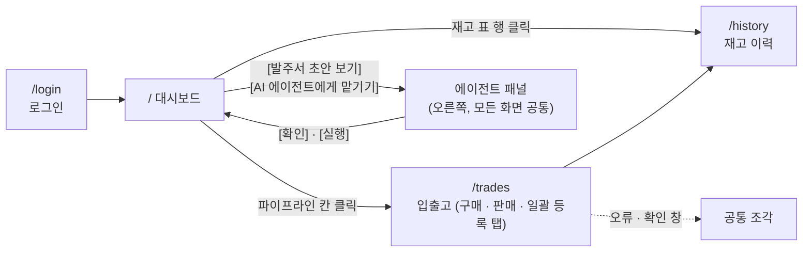

# 10. 화면 구성

작성일: 2026-11-20 · 기준: **계획서 5절과 WU-11~15 · WU-33 · 34 문서가 우선**이다. 컨셉 자료의 화면 시안(의사결정 회의 자료 슬라이드 14 · 15 · 18 · 19)은 배치 감을 잡는 참고로만 썼다.

- 그림은 영역 배치만 보여 준다. 색 · 글꼴 · 간격은 eple의 기본 스타일 토큰(`src/styles/`)을 따른다.
- testid 전체 목록은 각 WU 문서에 있다. 여기에는 영역을 찾는 데 필요한 것만 적는다.
- 모든 화면은 세 가지 상태를 갖는다: **로딩**(`Loading`), **빈 상태**(`EmptyState` — "아직 품목이 없어요. [시연 데이터 초기화]"), **오류**(`ErrorBanner` — 서버 `error.message` 그대로). 세 조각은 `src/components/common/`(eple).

## 1. 화면 지도



| 경로 | 화면 | 주인 | WU | 기능 |
|---|---|---|---|---|
| `/login` | 로그인 | eple | WU-03 | F-01 |
| (공통) | 앱 뼈대: 상단 바 · 내비 · 에이전트 자리 | eple | WU-05 | F-01, F-25 |
| `/` | 대시보드 | jkspawn | WU-11 | F-04, F-16 |
| `/trades` | 입출고 (구매 · 판매 · 일괄 등록 탭) | jkspawn | WU-12 · 13 · 14 | F-06~13, F-17~19 |
| `/history` | 재고 이력 | jkspawn | WU-14 | F-14, F-15 |
| (오른쪽 패널) | AI 에이전트 (발주 초안 · 대화) | skygaul | WU-33 · 34 | F-20~24 |

## 2. 앱 뼈대 (모든 화면 공통, eple)

```text
┌──────────────────────────────────────────────────────────────────────┐
│ PackFlow   대시보드 | 입출고 | 이력        [시연 데이터 초기화] a@… [로그아웃] │  ← 상단 바
├──────────────────────────────────────────────────┬───────────────────┤
│                                                  │                   │
│               페이지 내용 (jkspawn)              │  <AgentSlot />    │
│                                                  │  에이전트 패널     │
│                                                  │  (닫힘이 기본,     │
│                                                  │   열리면 폭 380px) │
│                                                  │   (skygaul)        │
└──────────────────────────────────────────────────┴───────────────────┘
```

- 계정 표시는 이메일 앞 몇 글자만(화면 녹화 · 캡처 대비).
- 휴대폰 폭에서는 내비가 위쪽 가로 스크롤, 에이전트 패널은 화면 전체를 덮는 시트로 열린다.
- [시연 데이터 초기화]는 jkspawn의 `components/demo/SeedResetButton`(WU-15) — 확인 창 뒤 `POST /api/seed`.

## 3. 로그인 (`/login`, eple)

```text
┌──────────────────────────────┐
│          PackFlow            │
│  이메일    [               ] │
│  비밀번호  [               ] │
│          [ 로그인 ]          │
│  오류: 이메일 또는 비밀번호가  │
│        맞지 않아요            │
└──────────────────────────────┘
```

- 회원가입 링크 없음(demo는 가입 닫힘, D-20 · 05 참고). 오류는 어느 쪽이 틀렸는지 구분하지 않는다.

## 4. 대시보드 (`/`, jkspawn, WU-11)

계획서 5절 "재고 현황판 — 감지 & 제안 카드". 시안 슬라이드 14 · 18(창고장의 아침)의 동선: **열기 → 품절 임박 알림 → 에이전트에게 맡기기**.

```text
┌───────────┬───────────┬───────────────┬───────────────┐
│ 품목 12   │ 재고 합계 │ 안전재고 미만 │ 오늘 입고 2   │   ← KPI 카드 4개
│           │ 486       │ 3  ⚠          │ 오늘 출고 5   │      kpi-*
└───────────┴───────────┴───────────────┴───────────────┘
┌──────────────────────────────────────────────────────────┐
│ ⚠ 품절 임박                         [AI 에이전트에게 맡기기] │  ← btn-agent-all
│ ┌────────────────────────┐ ┌────────────────────────┐     │
│ │ 노트북 거치대           │ │ 무선 마우스             │     │  ← alert-card-<sku>
│ │ 재고 3 / 안전재고 4     │ │ 재고 4 / 안전재고 5     │     │
│ │      [발주서 초안 보기] │ │      [발주서 초안 보기] │     │  ← btn-draft-po-<sku>
│ └────────────────────────┘ └────────────────────────┘     │
└──────────────────────────────────────────────────────────┘
 구매  [발주완료 2] › [이동·통관중 3] › [입고완료 14]           ← 파이프라인 (클릭 → /trades?status=)
 판매  [출고대기 5] › [출고완료 9]                               pipe-purchase-*, pipe-sale-*
┌──────────────────────────────────────────────┬───────────────┐
│ 품목별 재고                                   │ 최근 변경 5건  │
│ 코드     이름          재고  안전  상태       │ 14:02 PRD-001 │
│ PRD-001  무선 마우스      4     5  ●미만      │   −6 실판매출고│
│ PRD-002  USB-C 케이블    40    15             │ 13:40 PRD-002 │
│ PRD-003  노트북 거치대    3     4  ●미만      │   +8 구매입고  │
│ (행 클릭 → /history?sku_id=)  stock-row-<sku>│               │
└──────────────────────────────────────────────┴───────────────┘
```

- 숫자는 모두 `GET /api/dashboard` 값 그대로(화면에서 다시 계산하지 않음).
- 품절 임박 카드가 없으면 "지금 부족한 품목이 없어요"(빈 상태). 버튼은 `openAgentPanel(...)`만 부른다.
- 차트 자리 없음(MVP 이후). 표가 넓으면 가로 스크롤.

## 5. 입출고 (`/trades`, jkspawn, WU-12 · 13 · 14)

탭 세 개: **구매 · 입고** / **판매 · 출고** / **일괄 등록**. URL `?tab=&status=`로 상태 필터(대시보드 파이프라인에서 넘어옴).

### 5.1 구매 · 입고 탭

```text
 [구매 · 입고] [판매 · 출고] [일괄 등록]            상태: [전체 ▾]
┌──────────────────────────────────────────────────────────────────┐
│ + 발주 등록   품목 [PRD-001 ▾] 거래처 [      ] 수량 [ ] 금액 [ ]   │  form-purchase
│              송장번호(선택) [        ]                 [등록]      │
└──────────────────────────────────────────────────────────────────┘
 번호   품목      거래처    주문  도착   상태           버튼
 P-101  무선 마우스 가나물산  10    —     이동·통관중   [입고 확정] [발주 취소]
 P-100  USB-C      다라상사  20    18    입고완료 부분입고 [입고 취소]
 P-099  노트북 거치대 가나물산  5   —     품절           (종료)
```

- 버튼은 `PURCHASE_TRANSITIONS`의 다음 상태만. [입고 확정] → 도착 수량 입력 창(기본값 = 주문 수량).
- 취소류는 확인 창: "입고를 취소하면 재고가 8개 줄고, 기록은 남아요".

### 5.2 판매 · 출고 탭

```text
┌──────────────────────────────────────────────────────────────────┐
│ + 판매 등록   품목 [▾] 채널 [스마트스토어 ▾] 수량 [ ] 금액 [ ] [등록] │  form-sale
└──────────────────────────────────────────────────────────────────┘
 ⚠ 재고가 부족해요. PRD-001 남은 수량 4개                         ← error-banner
 번호   품목        채널         수량  상태       버튼
 S-201  무선 마우스  스마트스토어   6   출고대기   [출고] [주문 취소]   btn-ship-S-201
 S-200  USB-C       쿠팡           5   출고완료   [출고 취소]
```

- [출고] 성공 → 짧은 알림 "PRD-001 재고 10 → 4". 버튼은 처리 중 잠금(두 번 눌러도 한 번).

### 5.3 일괄 등록 탭 (시안 슬라이드 15 · 19 참고)

```text
 엑셀에서 6열(구분 · 품목코드 · 수량 · 거래처 · 송장번호 · 비고)을 복사해 붙여 넣으세요.
 [예시 붙여넣기]  [CSV 파일 선택]
┌──────────────────────────────────────────────────────────────────┐
│ 출고	PRD-001	3	스마트스토어	INV-1001	                          │  bulk-textarea
│ …                                                                │
└──────────────────────────────────────────────────────────────────┘
                                                        [미리보기]
 줄  구분  품목코드  수량  거래처        송장번호   결과
  1  출고  PRD-001     3  스마트스토어  INV-1001   ✓
  2  입고  PRD-999    10  가나물산      INV-1002   ✗ 미등록 품목코드
  3  출고  PRD-002     0  쿠팡          INV-1003   ✗ 수량이 0 이하
  4  출고  PRD-003     1  쿠팡          INV-1001   ✗ 같은 붙여넣기 안 송장번호 중복
                                          [유효한 1행 반영]   btn-bulk-commit
 결과: 1행 반영, 3행 제외                                   bulk-result
```

- 미리보기는 저장하지 않는다. 반영 뒤 같은 내용을 다시 반영하면 "이미 등록된 송장번호" 경고.
- 시안에 있던 "출고 건 → 배송 단계 연결"은 MVP 범위 밖.

## 6. 재고 이력 (`/history`, jkspawn, WU-14)

```text
 품목 [PRD-001 무선 마우스 ▾]            현재 재고 10 = 이력 합계 10 ✓
 시각          변화   사유         참조
 11/24 14:05   +6    출고취소     S-201
 11/24 14:02   −6    실판매출고   S-201
 11/24 09:00   +10   재고조정     seed
                                          [더 보기]   btn-more-logs
```

- 최근순 20건씩. 행 수정 · 삭제 버튼 없음(원장은 추가만).
- 검산 줄은 서버 값 두 개(`items.stock_qty`, 이력 합계)를 나란히 보여 준다.

## 7. AI 에이전트 패널 (오른쪽, skygaul, WU-33 · 34)

탭 두 개: **발주 초안** / **대화**. 시안 슬라이드 14 · 18의 "근거가 붙은 발주서 초안 → 수량 확인 → 승인" 동선.

### 7.1 발주 초안

```text
┌ AI 에이전트 ──────────────────── [×] ┐
│ [발주 초안] [대화]                    │
│ 품목         재고 안전 추천 단가  거래처 │
│ 노트북 거치대   3   4  [ 5]  12,000 가나 │  draft-row-<sku>, draft-qty-<sku>
│ 근거: 최근 7일 출고 4개(하루 0.6개),   │
│       입고 예정 0개, 안전재고 4개 기준  │
│ ───────────────────────────────────  │
│ 발주서 문안 (AI)                       │  draft-message
│ 가나물산 담당자님, 노트북 거치대 5개를 … │
│ ※ 발송은 시연용이에요. 실제로 보내지 않아요 │
│            [취소]  [발주 등록(확인)]     │  btn-draft-cancel / btn-draft-confirm
└───────────────────────────────────────┘
```

- 표의 숫자는 서버 계산 값. 문안 안의 숫자와 달라도 **저장은 표 값**.
- LLM 실패 · 상한 초과: 문안 자리에 "AI 문안을 만들지 못했어요(사유). 아래 계산 결과로 직접 발주할 수 있어요"(`draft-llm-error`). 표와 [발주 등록]은 그대로.

### 7.2 대화

```text
│ 나:  무선 마우스 재고 몇 개야?                  │
│ AI:  무선 마우스(PRD-001) 재고는 4개예요.        │  chat-reply-<n>
│ 나:  50개 출고해 줘                             │
│ AI:  재고가 부족해서 출고할 수 없어요. 남은 수량 4개 │  (refused)
│ 나:  3개 출고해 줘                              │
│ ┌ 이렇게 처리할까요? ─────────────────┐         │  chat-action-card
│ │ 무선 마우스 3개 직접 출고            │         │
│ │ 재고 4 → 1                          │         │
│ │            [취소] [실행]            │         │  btn-action-execute
│ └─────────────────────────────────────┘         │
│ [메시지 입력                      ] [보내기]      │  chat-input
```

- 변경은 카드의 [실행]을 눌러야만. 허용 밖 요청은 "할 수 없는 요청이에요"로 답한다.

## 8. 공통 조각 (eple, `src/components/common/`)

| 조각 | 쓰는 곳 | 규칙 |
|---|---|---|
| `ConfirmDialog` | 취소류 · 초기화 · 발주 확인 | 결과를 한 문장으로("재고가 6개 돌아오고, 기록은 남아요"). testid `confirm-ok` |
| `Toast` | 성공 알림 | "PRD-001 재고 10 → 4" 형식, 3초 |
| `ErrorBanner` | 모든 화면 · 패널 | 서버 `error.message`. `PF_INSUFFICIENT_STOCK`이면 남은 수량 문장 추가. testid `error-banner` |
| `Loading` · `EmptyState` | 모든 목록 | 빈 상태에는 다음 행동 버튼 하나 |

## 9. 시연 순서와 화면 (발표 · 백업 영상, WU-15)

ERP 주제 안내의 순서는 "로그인 → 입고 → 출고 → 품절 임박"이지만, `demo` 시드에서 P-101(PRD-001 입고)을 먼저 하면 재고가 18이 되어 출고 뒤에도 품절 임박 카드가 뜨지 않는다. 그래서 **출고 → 카드 → 입고** 순서로 보여 준다(WU-22 E2E `step1`과 같은 순서).

| 순서 | 화면 | 보여 줄 것 | 기능 |
|---|---|---|---|
| 1 | 로그인 | 시연 계정 A | F-01 |
| 2 | 입출고 › 판매 | S-201 출고 → 재고 10 → 4 | F-12 |
| 3 | 대시보드 | PRD-001 품절 임박 카드 | F-16 |
| 4 | 에이전트 › 발주 초안 | PRD-003 초안 → [확인] → 구매 목록에 `발주완료` | F-21 |
| 5 | 입출고 › 구매 | P-101 8개 입고 확정 → 부분 입고, PRD-001 재고 4 → 12 | F-07 |
| 6 | 입출고 › 판매, 이력 | 50개 출고 거부 / S-201 출고 취소 → 이력 −6 · +6 | F-12, F-13 |
| 7 | 에이전트 › 대화 | "50개 출고해 줘" 거부, "3개 출고해 줘" → [실행] | F-23 |
| 8 | 로그인 B | A 데이터 안 보임, 직접 호출 거부(테스트 결과 화면) | F-02 |
