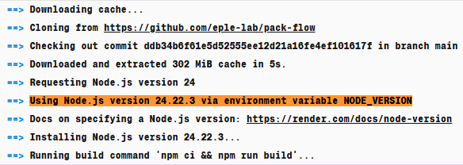
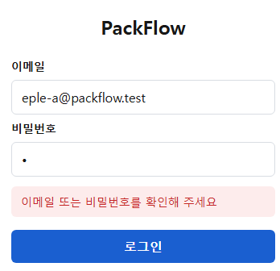
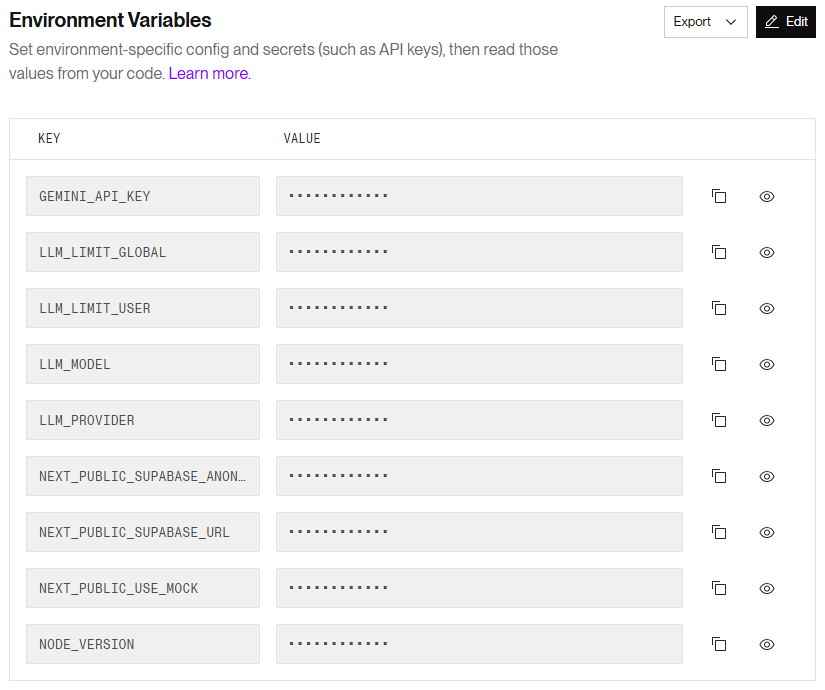
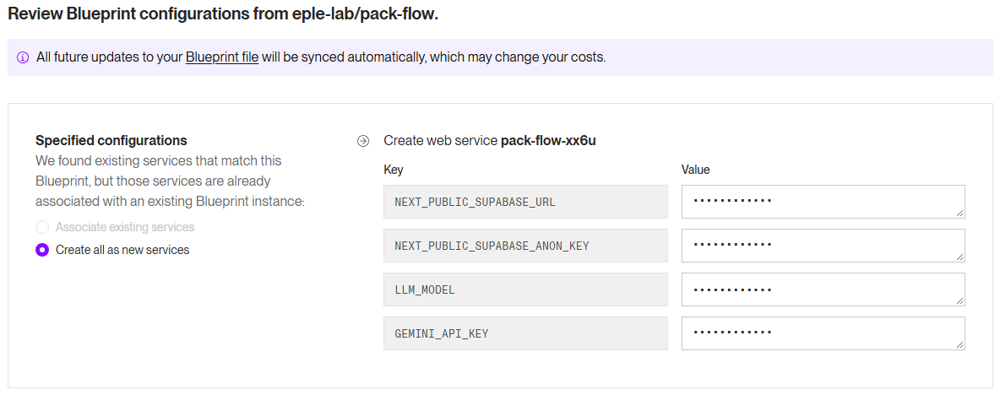

# WU-06 확인 기록 — Render 배포

작성일: 2026-11-23 · 작성: eple · 근거: [WU-00](../work-units/WU-00-skeleton.md) WU-06, D-05 · D-20 · D-27 · D-34

기대 결과를 먼저 적고 시험한다(D-34). 키 · 주소 · 프로젝트 ref는 적지 않는다.

## 1. 로컬 시험 (11/23 — `render.yaml`과 같은 빌드 · 시작 명령, `.env.local`의 dev 값)

| ID | 기대 | 실제 | 판정 |
|---|---|---|---|
| C-01 | `npm run build` 성공 | 성공, 화면 · API 경로 모두 빌드 | 통과 |
| C-02 | `PORT=3100 npm start` → `/api/health` 200 `{status:"ok", db:"ok"}` | 200 `{"data":{"status":"ok","db":"ok","llm":"gemini"}}` | 통과 |
| C-03 | 비로그인 `/items` → `/login`으로 보냄(실패해야 정상) | 307 → `/login?next=%2Fitems` | 통과 |
| C-04 | `render.yaml`에 비밀값 · 이메일 · 경로 없음, 서비스 키 칸 없음 | `check-secrets.sh --staged` 통과, 패턴 검사 결과 없음 | 통과 |

- `next start`는 `PORT` 환경변수와 0.0.0.0을 기본으로 쓴다(Next 16 CLI 문서) → Render 포트 설정 불필요
- `NODE_ENV`를 넣지 않는다: production이면 `npm ci`가 devDependencies(typescript)를 빼서 빌드 실패

## 2. Render 배포 (11/23 — 첫 배포는 dev 값, eple 결정)

배포 URL: https://pack-flow.onrender.com · Blueprint(`render.yaml`)로 eple이 서비스 생성 · 환경변수 입력. 첫 배포의 Supabase 값은 **dev 임시**(demo 준비 뒤 교체).

| ID | 기대 | 실제 | 판정 |
|---|---|---|---|
| C-05 | Render 빌드 로그에 Node 24 · 빌드 성공 | `Using Node.js version 24.22.3 via environment variable NODE_VERSION`, `Build successful` (eple, 3절 로그 · [캡처](img/wu06/c05-node-version.png)) | 통과 |
| C-06 | 배포 URL `/api/health` → 200 `ok/ok` | 200 `{"data":{"status":"ok","db":"ok","llm":"gemini"}}` (Claude, curl) | 통과 |
| C-07 | 배포 URL 비로그인 `/items` → `/login` | 307 → `/login?next=%2Fitems`, `/`도 307 → `/login` (Claude, curl) | 통과 |
| C-08 | 배포 URL 로그인 → 빈 대시보드 | dev 테스트 계정으로 로그인 성공(eple). **시연 계정 A(demo)는 demo 교체 뒤** | 일부 |
| C-09 | 틀린 비밀번호 로그인 → 오류 문구, 대시보드로 가지 않음(실패해야 정상) | "이메일 또는 비밀번호를 확인해 주세요", 로그인 화면에 머묾 (eple, [캡처](img/wu06/c09-wrong-password.png)) | 통과 |
| C-10 | Render 환경변수 목록에 서비스 키 없음 | 9개(`GEMINI_API_KEY` · `LLM_*` 4개 · `NEXT_PUBLIC_*` 3개 · `NODE_VERSION`) 중 서비스 키 없음 (eple, [환경변수 캡처](img/wu06/c10-render-env.png)). 첫 배포 때 입력 칸은 `sync: false` 4개뿐 ([Blueprint 캡처](img/wu06/c10-blueprint-first-deploy.png)) | 통과 |
| C-11 | 배포 URL 비로그인 `/api/me` → 401 `PF_UNAUTHENTICATED`(실패해야 정상) | 401 `PF_UNAUTHENTICATED` (Claude, curl) | 통과 |

- 주의: demo로 바꾸기 전까지 dev 주소 · 공개 키가 배포 번들에 실리고 dev 회원가입이 켜져 있다 → demo 교체가 끝나면 해소
- 무료 플랜은 15분 미사용 시 잠들어 첫 응답이 느리다(시연 직전에 한 번 열어 둔다)

## 3. 증거

### C-05 Render 빌드 · 배포 로그 (11/23, `pack-flow` 서비스, 커밋 `ddb34b6` — 내부 주소 줄은 뺌)

```text
==> Downloading cache...
==> Cloning from https://github.com/eple-lab/pack-flow
==> Checking out commit ddb34b6f61e5d52555ee12d21a16fe4ef101617f in branch main
==> Downloaded and extracted 302 MiB cache in 5s.
==> Requesting Node.js version 24
==> Using Node.js version 24.22.3 via environment variable NODE_VERSION
==> Installing Node.js version 24.22.3...
==> Running build command 'npm ci && npm run build'...

> pack-flow@0.1.0 prepare
> node scripts/install-hooks.mjs

[hooks] core.hooksPath = .githooks (비밀값 검사 훅이 켜졌습니다)

added 386 packages, and audited 387 packages in 8s
found 0 vulnerabilities

> pack-flow@0.1.0 build
> next build

▲ Next.js 16.4.6 (Turbopack)
✓ Compiled successfully in 246ms
  Finished TypeScript in 2.0s ...
✓ Generating static pages using 31 workers (22/22) in 524ms

ƒ Proxy (Middleware)

==> Build successful 🎉
==> Deploying...
==> Running 'npm start'

> pack-flow@0.1.0 start
> next start

▲ Next.js 16.4.6
✓ Ready in 1385ms
==> Your service is live 🎉
==> Available at your primary URL https://pack-flow.onrender.com
```

- `npm ci` 때 훅 설치 스크립트가 배포 서버에서도 실패 없이 지나감(WU-01 설계대로), 취약점 0건
- 포트는 Render가 준 값(10000)을 `next start`가 그대로 씀 — 포트 설정 불필요(1절)



### C-09 틀린 비밀번호



### C-10 Render 환경변수 · 첫 배포 입력 칸




